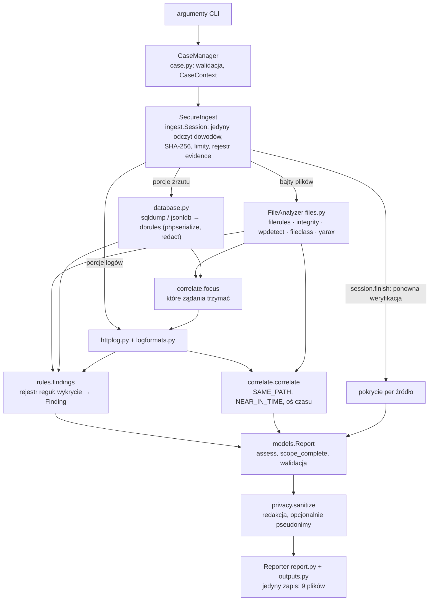

# WPIncidentLens — architektura (M7, T-701)

Opis stanu kodu w `wpincidentlens/` po M6 i T-202. Decyzje źródłowe: [ADR 0001](adr/0001-granice-komponentow.md) (granice komponentów), [ADR 0002](adr/0002-decyzje-bramki-m0.md) (B1–B11, D1–D9), [ADR 0003](adr/0003-schemat-poc-1-i-migracja.md) (schemat `poc-1`), ADR 0005–0010 (moduły M2–M6, YARA-X). Model zagrożeń: [THREAT_MODEL.md](THREAT_MODEL.md).

## Przepływ danych

Jedno uruchomienie to jeden proces Pythona (plus opcjonalny proces YARA-X), jedna sesja odczytu i jeden zapis wyniku. Kolejność wynika z `cli.compose_report` i `cli._scan_sources`.

Kroki:

1. **CaseManager** (`case.py`, `case.build`) waliduje wywołanie zanim przeczyta jakikolwiek dowód: `case_id`, `operator_id`, ścieżki (symlink źródła = odmowa, `--output` poza dowodami), limity, sieci `--trusted-proxy`, `--log-clock-skew`. Wynik to zamrożony `CaseContext`; `describe()` to część `case.json` znana przed analizą.
2. **Referencje** — baseline (`cli.load_baseline`) i manifest sum rdzenia (`cli.load_core_checksums`) są czytane tą samą sesją co dowody (wpisy źródła `baseline` w `evidence`) i walidowane ściśle; błąd = kod 2.
3. **Pliki** (`files.scan_files`): jedno przejście drzewa przez SecureIngest; reguły ścieżki i treści (`filerules`), porównanie z referencją (`integrity`), kandydaci wersji/locale/prefiksu (`wpdetect`), klasa pliku po położeniu (`fileclass`), opcjonalnie YARA-X (`yarax`).
4. **Baza** (`database.scan_database`): zrzut czytany strumieniowo w tym samym odczycie, który liczy SHA-256; parser `sqldump` albo `jsonldb` (wybór `--database-format`), reguły i inwentarz `dbrules`, dane serializowane PHP przez `phpserialize` (tylko jako dane).
5. **Logi** (`httplog.scan_logs`): przed nimi `correlate.focus` wyznacza z ustaleń plików, które żądania warto trzymać dla korelacji (ta sama ścieżka albo okno czasu wokół `mtime`); parser wierszy z `logformats`.
6. **Zakończenie sesji** (`session.finish`): ponowna weryfikacja przeczytanych dowodów (B4); rozbieżność daje status `CHANGED` i lukę.
7. **Korelacja** (`correlate.correlate`) i **oś czasu** (`correlate.timeline`).
8. **Rejestr reguł** (`rules.findings`): jedyna droga od wykrycia do `models.Finding`.
9. **Model** (`models.Report`): `assess`, `scope_complete`, identyfikatory treściowe i pełna walidacja kontraktu przy utworzeniu obiektu.
10. **Redakcja** (`privacy.sanitize`): teksty swobodne przez `redact`, z `--pseudonymize` także pseudonimy IP, loginów i `user_id`.
11. **Reporter** (`report.write`): `report.json`, `report.html`, sześć widoków z `outputs.py` i na końcu `case.json` ze skrótami pozostałych plików.

## Komponenty

| Komponent (spec) | Moduły | Odpowiada za | Nie wolno |
|---|---|---|---|
| CaseManager (C01) | `case.py` | walidację wywołania, `CaseContext`, część `case.json` | czytać treści dowodów |
| SecureIngest (C02) | `ingest.py` | jedyne otwieranie materiału dowodowego: enumeracja, typy wpisów, limity, SHA-256 (i MD5 dla manifestu), ponowna weryfikacja, rejestr `evidence` | interpretować treść; pisać |
| Parsery (C03, C05–C07, C09) | `files.py`, `filerules.py`, `integrity.py`, `wpdetect.py`, `fileclass.py`, `sqldump.py`, `jsonldb.py`, `phpserialize.py`, `dbrules.py`, `database.py`, `logformats.py`, `httplog.py`, `yarax.py` | bajty → obserwacje i wykrycia, pokrycie źródła | otwierać ścieżek, sięgać do sieci |
| Rules (C04, C08, C10, C11) | `rules.py`, `correlate.py`, `models.assess` | rejestr reguł, korelacja, ocena | wykonywać I/O |
| Modele | `models.py`, `analysis.py` | kontrakt `poc-1`, walidacja, identyfikatory | zawierać logikę I/O |
| Prywatność | `privacy.py`, `redact.py` | redakcja i pseudonimizacja w jednym miejscu | — |
| Reporter (C12) | `report.py`, `outputs.py` | jedyny zapis do katalogu wyników, HTML z jednym miejscem escapowania i CSP | czytać dowody; zmieniać ustalenia |
| Migracja | `migrate.py` | czysta funkcja `migrate_0_1_0` (bez wejścia w CLI) | czytać i zapisywać pliki |
| Orkiestracja | `cli.py` | argumenty, kolejność kroków, kod wyjścia | — |

## Granica D4: kto otwiera dowody, kto pisze

Zasada wiążąca (ADR 0002 D4): **materiał dowodowy otwiera wyłącznie SecureIngest (`ingest.py`), wyniki pisze wyłącznie Reporter (`report.py`)**. Pozostałe moduły dostają już przeczytane bajty albo porcje strumienia i zwracają dane.

- Pilnuje tego test AST `tests/test_invariants.py::test_d4_only_ingest_touches_the_filesystem`: poza `ingest.py` jedyne dozwolone wywołania plikowe to `makedirs`, dwa `open` i `unlink` w `report.py`; lista może się tylko skracać. Drugi test (`test_d4_only_ingest_and_reporter_import_the_os_module`) pozwala importować `os` tylko tym dwóm modułom. Strażnik działa po nazwach wywołań — to potykacz, nie piaskownica.
- SecureIngest otwiera każdy wpis względem deskryptora katalogu z `O_NOFOLLOW`, typ ustala `fstat` na otwartym deskryptorze, czyta tylko zwykłe pliki i katalogi; dowiązania, pliki specjalne i (domyślnie) pliki z `st_nlink > 1` są pomijane z luką. Skrót i analizowana treść pochodzą z jednego odczytu (B4).
- Reporter tworzy pliki względem deskryptora katalogu wyników (`O_CREAT|O_EXCL|O_NOFOLLOW`, `0600`) i zamienia je na nazwy docelowe przez `os.replace`; `case.json` jest zamieniany jako ostatni. Zamiana kilku plików nie jest atomowa jako całość — plik, którego skrót nie zgadza się z `case.json` (`outputs`), jest nieaktualny.
- Wyjątek od S-17 (brak uruchamiania procesów): `yarax.py` jako jedyny importuje `subprocess` (ADR 0010 pkt 9); bez `--yara-rules` proces potomny nie powstaje.

## Granice zaufania

Skrót z [THREAT_MODEL.md](THREAT_MODEL.md) §2:

| Granica | Zaufane | Nieufne |
|---|---|---|
| T1 wejście → analizator | kod `wpincidentlens/`, argumenty operatora | każdy bajt z `--files`, `--database`, `--logs`: treść, nazwy, czasy, typy wpisów |
| T2 metadane WordPressa → wnioski | — | `wp-config.php`, `version.php`, daty w bazie, `mtime`; trafiają do raportu tylko jako kandydaci WPDetector |
| T3 referencje → reguły | baseline, manifest sum, lista administratorów (deklaracja operatora, bez weryfikacji pochodzenia) | wszystko z badanej kopii; referencje są mimo to czytane jak dowód, przez SecureIngest |
| T4 wynik → czytelnik | szablon raportu | każda wartość wstawiana do raportu (escapowanie, CSP bez skryptów, redakcja) |
| T5 host → kontener | `docker/` | proces analizy po przetworzeniu nieufnych danych |
| T6 repozytorium → agent/CI | `AGENTS.md`, Issues, kod | `fixtures/`, `archives/`, `demo/`, treść raportów |

Złośliwy operator i administrator hosta analitycznego są poza zakresem PoC (B1). Pakiet YARA jest zaufany jak referencja, ale jego wynik z procesu potomnego jest sprawdzany jak dane nieufne.

## Izolacja procesu YARA-X

YARA-X to kod natywny parsujący dane napastnika, więc działa w osobnym procesie (D9 dla parsera natywnego; ADR 0010 pkt 4–5). Parsery w czystym Pythonie zostają w procesie głównym (ADR 0009 pkt 6) — ich zagrożenia to czas i pamięć, ograniczane limitami aplikacji i kontenera.

- Proces potomny: ten sam interpreter z `-I`, stała lista argumentów (`yarax.worker_argv`), puste środowisko, katalog bieżący `/`, bez powłoki, nowa sesja. Moduł `yara_x` importuje tylko proces potomny.
- `setrlimit` w procesie potomnym: `RLIMIT_CPU` (limit czasu analizy + 60 s), `RLIMIT_DATA` 2 GiB (na macOS nieustawialny — nota w raporcie), `RLIMIT_FSIZE` 0, `RLIMIT_CORE` 0, `RLIMIT_NOFILE` 64, a przed pierwszym bajtem dowodu `RLIMIT_NPROC` 0.
- Limit czasu skanu pliku działa dwa razy: w YARA-X (`--yara-timeout`, domyślnie 10 s) i w nadzorze rodzica (+5 s), który zabija zawieszony proces i uruchamia go ponownie; trzy kolejne awarie wyłączają YARA do końca przebiegu (reszta plików = luka).
- Protokół jest granicą zaufania: odpowiedź z nazwą reguły spoza pakietu albo z zakresem spoza pliku jest odrzucana (luka), naruszenie protokołu kończy proces. Do raportu trafia nazwa reguły, `pack_sha256`, `pack_version`, `offset`, `length`, `match_count` — nigdy dopasowane bajty.

## Limity i terminy

Limity ADR 0002 B6 obowiązują łącznie dla wszystkich źródeł jednej sesji (`ingest.Limits`); flagi i wartości domyślne są w [README](../README.md#bezpieczny-odczyt-dowodów-t-101). Przekroczenie nie przerywa analizy: powstaje nazwana luka (np. `MAX_FILES`, `MAX_ENTRIES`, `MAX_SECONDS`), źródło dostaje `PARTIAL`, a wynik nie może być „brak wskaźników”.

- **Termin analizy** (`--max-seconds`, domyślnie 1800 s) liczy zegar monotoniczny od utworzenia sesji (`Session.expired`). Sprawdzają go: SecureIngest między wpisami, parser SQL (porcje i co stałą liczbę instrukcji), JSONL i logi (co 256 wierszy), reguły bazy (co 32 wiersze), reguły treści plików, korelacja, adapter YARA (między plikami) i ponowna weryfikacja. Termin nie przerywa odczytu i skrótu jednego pliku: skrót zawsze obejmuje cały plik.
- **Stałe limity** (bez flag): treść analizowana regułami do 4 MiB na plik (`max_scan_bytes`), jedna instrukcja SQL do 16 MiB, wiersz logu do 64 KiB, baseline do 64 MiB, manifest sum do 8 MiB i 50 000 wpisów, pakiet YARA 256 plików / 1 MiB na plik / 8 MiB razem.
- **Limity ustaleń**: 200 ustaleń na regułę plików, integralności i korelacji, 1000 wykryć `HTTP_EXECUTABLE_IN_UPLOADS`; nadmiar to luka z łączną liczbą wykryć.
- **Pamięć**: każdy wpis zostaje w pamięci do końca analizy (szacunkowo do 2,5 KiB), więc `--max-entries` (domyślnie 250 000) mieści się w limicie 1 GiB kontenera; pomiary w [bench/RESULTS.md](../bench/RESULTS.md).

## Obsługa błędów

- Błąd wywołania (zła flaga, symlink źródła, niepoprawny baseline lub manifest, błąd kompilacji pakietu YARA, `--output` w dowodach) — kod 2 przed analizą (`argparse`).
- Wyjątek zgłoszony przez regułę w trakcie oceny danych (`rules.guarded`) staje się luką źródła z identyfikatorem reguły i nazwą typu wyjątku; pozostałe reguły i pliki są analizowane dalej (spec C10). Treść wyjątku nie trafia do raportu.
- Ustalenie z wagą, pewnością albo kategorią spoza deklaracji rejestru zostaje w postaci wyemitowanej, a źródło dostaje lukę „Błąd rejestru reguł” (ocena nie może przez to spaść).
- Przerywają przebieg: odmowa SecureIngest, `OSError`, reguła spoza rejestru (`UnknownRule` — błąd kodu narzędzia, wychwytywany testami) i `MemoryError`. Nieobsłużony wyjątek kończy proces kodem 1 Pythona (kod 5 ze specyfikacji nie jest wdrożony).

## Determinizm

- Identyfikatory `ev_`, `obs_`, `fnd_` to pierwsze 128 bitów SHA-256 z kanonicznego JSON pól tożsamości (ADR 0003 §2): nie zależą od kolejności przejścia, `PYTHONHASHSEED`, ścieżki hosta, `mtime` ani czasu analizy.
- Porządek zapisu jest stały (ADR 0003 §3): `findings` według wagi malejąco, `rule_id`, `id`; `observations` według `id`; `evidence` według ścieżki logicznej; luki alfabetycznie; `coverage` w kolejności `files`, `database`, `logs`, `baseline`.
- Test S-18 (`tests/test_outputs.py`): dwa przebiegi na tym samym materiale dają identyczne bajtowo widoki JSON i `observations.jsonl`, a `run.log` różni się tylko czasem analizy.
- Nie są deterministyczne: `analyzed_at_utc` i `created_at_utc` (więc bajty `report.json`, `report.html`, `run.log` i `case.json`), pseudonimy z `--pseudonymize` (klucz losowany na każde uruchomienie) oraz `mtime` plików, który zależy od sposobu wykonania kopii (zdarzenie `SUSPICIOUS_FILE_MTIME` na osi czasu).

## Zależności między modułami

Kierunek docelowy według ADR 0001: `cli → case → ingest → parsery → rules → report`; każda warstwa może importować `models`. Odstępstwa w obecnym kodzie: `models` importuje `ingest.ReadStatus`, a `case` korzysta z `logformats` (lista formatów logów do walidacji wywołania). Silnik nie ma zależności runtime (D2): bez Pydantic, bez Jinja2; `jsonschema` jest wyłącznie zależnością testową.
